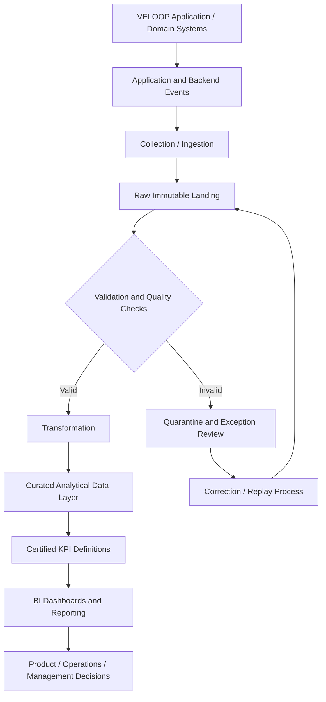

# Proposed Analytics Pipeline

This is a design proposal, not a verified description of VELOOP's current production infrastructure.

## Design principles

1. Preserve raw source data for traceability.
2. Validate schema, identifiers, timestamps, statuses and relationships at ingestion.
3. Quarantine invalid records rather than silently dropping or coercing them.
4. Make transformation logic reproducible and version-controlled.
5. Define a certified analytical layer with explicit entity grain and KPI definitions.
6. Monitor freshness, volume, schema drift, validation failures and pipeline health.
7. Assign ownership for source systems, event contracts, quality rules and business metrics.

## Implementation status

All stages above are proposed. The assignment evidence does not verify VELOOP's current production collector, storage platform, transformation engine, BI platform, SLAs or operating ownership.
